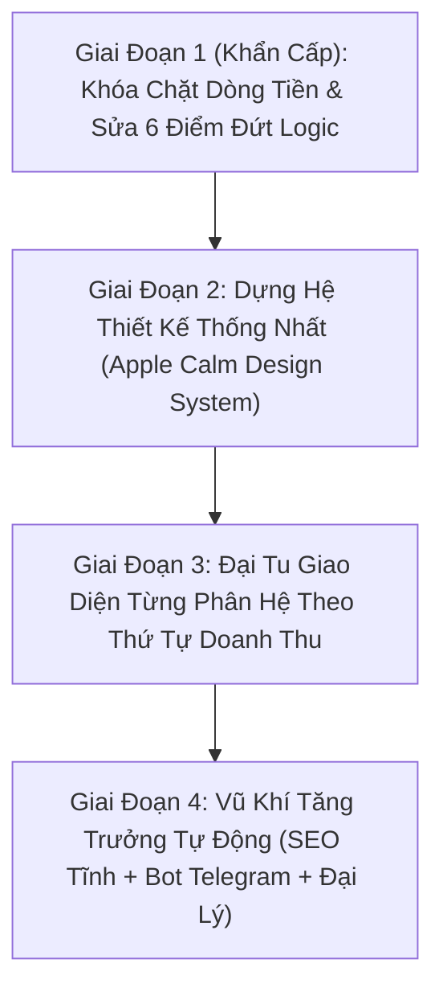

# Báo Cáo Kiểm Toán Toàn Diện IPAVIET 4.0 — Dòng Tiền, Bảo Mật Logic & Đại Tu UI/UX Chuẩn "Người Thật Làm"

> [!IMPORTANT]
> Tài liệu này tổng hợp kết quả quét đa lớp toàn bộ **18 trang HTML**, **5 hệ thống CSS**, **`firestore.rules`**, **`app-library/ipaviet-vip-sign.js`** và Backend **`GoogleAppsScriptComplete_WITH_KEYS.js`** tại commit `7d1fe6b`.

---

## PHẦN 1: KIỂM TOÁN DÒNG TIỀN & CÁC HẠNG MỤC ĐÃ TRIỂN KHAI (GÓC NHÌN NHÀ SÁNG LẬP)

### 1.1. Bảng Chấm Điểm Thực Tế 10 Hạng Mục & Điểm Đứt Gãy Ngầm

| # | Hạng Mục | Trạng Thái Thật | Phát Hiện Kỹ Thuật Trong Code & Cách Khắc Phục Triệt Để |
| :-: | :--- | :---: | :--- |
| **1** | **Order Bump Cert (+25k VIP 30 ngày & +29k AppleCare+)** | 🟡 Thu tiền OK, **chưa tự kích hoạt VIP** | `certapple/checkout.html` đã cộng tiền vào VietQR và lưu `hasVipAddon: true`, `hasInsuranceAddon: true`. Tuy nhiên `submitCertFulfillment()` trong `admin.html` và `fulfill_cert_order` trong `GoogleAppsScriptComplete_WITH_KEYS.js` chưa đọc 2 cờ này. **Cần bổ sung:** Khi Admin duyệt đơn có `hasVipAddon`, tự động cộng +30 ngày `vipExpire` cho khách. |
| **2** | **Smart Cross-Sell Card (`app.html` -> Chợ MMO)** | 🟢 Hoạt động tốt | Nhận diện từ khóa mượt. Cần gắn thêm tham số `?utm_source=ipa_cross_sell` để đo chính xác bao nhiêu đơn MMO đến từ trang chi tiết IPA. |
| **3** | **Kệ VIP Vault (`#railVipVault`) tại Kho IPA** | 🟢 Hoạt động tốt | Đã hiển thị trên trang chủ Kho IPA. |
| **4** | **WebClip `.mobileconfig` cài App ra màn hình chính** | 🟡 Hoạt động, **chưa ký SSL** | Khi cài trên iOS hiện nhãn đỏ *"Chưa xác minh (Not Verified)"*. Có thể ký bằng chứng chỉ SSL của domain `ipaviet.site` để hiện tích xanh *"Đã xác minh"*. |
| **5** | **Kinh Tế Kép (`coins` vs `bonusCoins`)** | 🔴 **Lệch với `firestore.rules`** | 1) Trường `bonusCoins` và `bonusXu` chưa được đưa vào hàm `touchesProtectedUserFields()` trong `firestore.rules` -> user biết dùng F12 Console có thể tự cộng Xu thưởng. 2) Tại `dichvu.html` (dòng 1122), khi khách mua VIP bằng ví, client tự ghi `vipExpire` và `vip: true` -> bị `firestore.rules` chặn! **Cách sửa:** Gọi hàm `updateVipOnFirestore(uid, addedDays)` đã có sẵn ở dòng 119 của `GoogleAppsScriptComplete_WITH_KEYS.js`. |
| **6** | **Tab Quản Lý Kho IPA + Apple iTunes API (`admin.html`)** | 🟢 Hoạt động tốt | Lấy thông tin từ iTunes API nhanh (1 giây). Lưu ý công cụ quét link chết chạy trên trình duyệt sẽ bị CORS chặn với các link Google Drive/GitHub Releases nên cần chuyển lệnh kiểm tra HEAD sang Apps Script. |
| **7** | **Tự động bơm Cert vào Tủ Đồ khách (`vipCert`)** | 🔴 **Đang đứt ở 2 chỗ** | 1) `certapple/checkout.html` (dòng 1513 & 1628) gán cứng `uid: 'CLIENT_' + Date.now()` thay vì `firebase.auth().currentUser.uid`, nên khi Admin trả hàng, Cert bị bơm vào document rác `users/CLIENT_...`. 2) Module `app-library/ipaviet-vip-sign.js` đọc `vipCert.p12Data` & `vipCert.mpData` (Base64), nhưng `admin.html` chỉ lưu `p12Url` (link zip). **Cách sửa:** Lấy đúng `auth.currentUser.uid` lúc checkout; khi Admin thả file `.zip` vào `processSmartCertFiles` (vốn đã giải nén bằng `JSZip`), trích luôn `p12Data` và `mpData` Base64 lưu vào `users/{uid}.vipCert`. |
| **8** | **Private VIP Repo (`repo/vip.json`)** | 🔴 **Đang lộ công khai** | `repo/vip.json` là file tĩnh trên GitHub Pages, tham số `?token=uid` không được kiểm tra -> ai có link cũng tải chùa được toàn bộ 319 app VIP. **Cách sửa:** Phục vụ JSON qua `GoogleAppsScriptComplete_WITH_KEYS.js` (dùng hàm `vipCertIsVipActive_(uid)` đã có sẵn ở dòng 3160) hoặc Cloudflare Worker. |
| **9** | **Cloner Studio, Ngụy trang & Pay-per-Sign (`sign-app/`)** | 🔴 **4 lỗi cần sửa ngay** | 1) 3 công tắc AdBlock / 120Hz / Fake GPS đang thu +2.000 Xu nhưng backend `https://ipa.ipasign.cc/sign` không nhận tham số tiêm dylib -> phải tắt thu phí 3 ô này. 2) Đang trừ Xu **trước** khi ký; nếu ký lỗi khách mất Xu oan -> phải dời lệnh trừ Xu sang bước ký thành công (`finalizeInstallationView`). 3) Bundle ID ngụy trang đang dùng `com.apple.calculator.custom` (tiền tố `com.apple.*` bị iOS cấm) -> đổi thành `vn.ipaviet.calc`. 4) Đồng bộ đọc `p12Data` & `mpData` từ `users/{uid}.vipCert` giống `ipaviet-vip-sign.js`. |
| **10** | **Hệ thống Affiliate / CTV 15%** | 🔴 **Bị `firestore.rules` chặn & hở số dư** | 1) `firestore.rules` chỉ cho phép sửa document của chính mình -> khách mua VIP hoặc click link ref không thể cộng `affiliateBalance` / `affiliateClicks` sang document của CTV; chưa có rule cho `withdrawal_requests`. 2) `affiliateBalance` chưa nằm trong `touchesProtectedUserFields()` -> user tự sửa được số dư hoa hồng qua Console. **Cách sửa:** Khóa các trường `affiliate*` trong `firestore.rules` và xử lý cộng hoa hồng / tạo lệnh rút tiền qua `GoogleAppsScriptComplete_WITH_KEYS.js`. |

---

## PHẦN 2: QUÉT ĐA LỚP UI / UX / ANIMATION — TẠI SAO WEB NHÌN "RỜI RẠC" VÀ "BỊ AI"?

### 2.1. Bảng Số Liệu Đo Đạc Thực Tế Trên Toàn Bộ 18 Trang

| Lớp Giao Diện | Thực Trạng Đang Chạy Trên Web | Chuẩn Thiết Kế Chuyên Nghiệp (Apple / Linear / Stripe) |
| :--- | :--- | :--- |
| **1. Kiến trúc CSS** | **5 hệ thống chồng chéo**: `lucian-tokens.css`, `tokens.css`, `minimalist-modern.css`, `maclife-store.css` (3.518 dòng), `applecert.css` + Tailwind CDN + CSS inline mỗi trang một kiểu. | **1 file `tokens.css` + 1 file `components.css`** dùng chung toàn hệ thống. |
| **2. Chế độ Sáng / Tối** | Trang chủ sáng (`#f5f5f7`), Cert sáng tông đỏ (`data-cc-xem="sang"`), Checkout Cert ép tối (`class="dark"`), Sign App ép tối (`#07090e`), Claim ép tối (`data-theme="dark"`). **Mỗi lần chuyển trang là chớp màn hình đổi tông.** | **Đồng nhất 1 cơ chế Theme** xuyên suốt toàn bộ hành trình người dùng. |
| **3. Bảng màu nhấn (Accent)** | **9 màu chính đánh nhau**: `#0071e3`, `#0a84ff`, `#0066ff`, `#0052ff`, `#2563eb`, `#7c3aed` (VSign), **`#e10e0e` (Đỏ ở Cert)**, `#10b981` (Support), `#f59e0b` (VIP). | **90% diện tích là Trắng / Xám tĩnh**. Chỉ dùng **1 màu nhấn `#0071e3`** + 1 màu Vàng trầm cho VIP. |
| **4. Typography (Font chữ)** | **6 font chữ**: `-apple-system`, `Inter`, `Plus Jakarta Sans`, `Saira Semi Condensed` (`phim-tat.html`), `Playfair Display`, `JetBrains Mono`. | **1 họ Sans-serif duy nhất** (`-apple-system, BlinkMacSystemFont, "SF Pro Display", "Inter"`) + **1 họ Mono** cho mã UDID/đơn hàng. |
| **5. Hệ thống Icon** | Trộn **Font Awesome + Lucide + SVG vẽ tay + hơn 500 Emoji** (`support.html`: 208 emoji, `admin.html`: 132 emoji, `app.html`: 90 emoji, `app-library/index.html`: 61 emoji). | **1 bộ Vector Icon duy nhất (Lucide stroke 1.75px)**. Tuyệt đối không dùng Emoji làm icon chức năng. |
| **6. Thanh điều hướng (Nav)** | **9 kiểu Header/Nav khác nhau**: `header-bar`, `sidebar-nav`, `apple-glass`, `glass-header` + `floating-nav`, `thanh-duoi`, `global-nav`, `app-header`, cửa sổ macOS giả (`sign-app`). | **1 Khung App Shell duy nhất**: Top Header 56px + Bottom Tab Bar 5 mục trên iPhone. |
| **7. Animation & Motion** | **107 vòng lặp `animation: ... infinite`**, **197 hiệu ứng `glow/pulse/shimmer`** riêng ở Kho IPA, **8 hàm `cubic-bezier` khác nhau**, chữ tự nhảy ký tự ma trận ở trang chủ. | **Chỉ chuyển động khi người dùng tương tác**. Dùng đúng 2 đường cong `cubic-bezier` và tắt toàn bộ hiệu ứng nhấp nháy vô hạn. |

### 2.2. 8 "Dấu Vân Tay AI" Khiến Khách Nhìn Vào Thấy Kém Tự Nhiên (Và Cách Khử Sạch)

1. **Lạm dụng Emoji trong tiêu đề và nút bấm (`🪙`, `👑`, `🔥`, `⚡`, `🚀`):**
   - *Biểu hiện:* `🪙 Nạp Thêm Xu`, `👑 VIP Tới...`, `☁️ Tủ Đồ VIP`.
   - *Cách khử:* Thay 100% bằng icon vector đơn sắc tinh tế của Lucide.
2. **Viết Hoa Mọi Chữ Cái Đầu Trong Tiếng Việt (English Title Case):**
   - *Biểu hiện:* *"Tủ Đồ Chứng Chỉ Apple & Hạn Bảo Hành"*, *"Tiếp Thị Liên Kết & Kiếm Tiền CTV"*, *"Bạn Chưa Có Chứng Chỉ Apple"*.
   - *Cách khử:* Viết đúng chuẩn tiếng Việt tự nhiên như trang chủ Apple Việt Nam — chỉ viết hoa chữ cái đầu câu và danh từ riêng: *"Tủ đồ chứng chỉ Apple"*, *"Chương trình cộng tác viên"*, *"Bạn chưa có chứng chỉ Apple"*.
3. **Ngôn ngữ quảng cáo cường điệu ("Văn mẫu AI"):**
   - *Biểu hiện:* *"Đẳng cấp"*, *"Siêu tốc"*, *"Thần tốc"*, *"Độc quyền 100%"*, *"Động cơ C++ RAM thực thi CodeSign"*.
   - *Cách khử:* Viết ngắn, điềm tĩnh, nói thẳng vào lợi ích thật: *"Ký và cài ứng dụng trực tiếp trên iPhone"*, *"Bảo hành đổi mới 240 ngày"*.
4. **Thẻ "Cầu vồng Gradient" + Viền phát sáng (Neon Glow):**
   - *Biểu hiện:* Trong `account.html` và `app.html`, mỗi khối là một hộp gradient màu khác nhau (xanh dương, vàng, tím, xanh lá) xếp sát nhau.
   - *Cách khử:* Đổi tất cả các thẻ về nền trắng `#ffffff` (hoặc `#1c1c1e` ở chế độ tối) với viền mảnh `1px solid rgba(0,0,0,0.07)` và bóng đổ mềm. Phân biệt các mục bằng icon nhỏ gọn thay vì tô màu cả hộp.
5. **Giao diện mô phỏng giả (Fake Skeuomorphism):**
   - *Biểu hiện:* 3 nút Đỏ-Vàng-Xanh của cửa sổ macOS trên web điện thoại, màn hình terminal giả `codesign-engine — zsh — 80x24` trong `sign-app/index.html`.
   - *Cách khử:* Thay bằng thanh tiến trình (progress bar) tối giản, sạch sẽ chuẩn iOS 18.
6. **Bằng chứng xã hội giả (Fake Social Proof):**
   - *Biểu hiện:* Popup *"Nguyễn Văn A vừa mua gói..."* chạy lặp mỗi 8.5 giây ở `index.html`; điểm số cứng *"4.9★ — 1,2N ĐÁNH GIÁ"* giống hệt nhau ở mọi ứng dụng trong `app.html`.
   - *Cách khử:* Gỡ bỏ popup giả; thay hàng thông số của `app.html` bằng dữ liệu thật của chính file IPA đó: **Phiên bản · Dung lượng · Hệ điều hành hỗ trợ (`iOS 15+`) · Lượt tải thật**.
7. **Quá nhiều nút CTA ngang hàng trên một màn hình:**
   - *Biểu hiện:* Phần đầu trang `app.html` có 5 nút nằm ngang (`NHẬN`, `Ký VSign`, `Nhân Bản`, `Bookmark`, `Share`), khiến nút quan trọng nhất bị chìm.
   - *Cách khử:* Giữ đúng **1 nút chính `NHẬN` (hoặc `Cài đặt`)** nổi bật và **1 nút phụ `Tùy chọn ký ⋯`** mở bảng chọn (Ký bằng chứng chỉ riêng, Nhân bản ứng dụng, Chia sẻ).
8. **Popup `SweetAlert2` (`Swal.fire`) mặc định:**
   - *Biểu hiện:* Nhiều trang bật hộp thoại `Swal.fire` với icon dấu chấm than/dấu tích hoạt hình to tướng của thư viện ngoài, phá vỡ hoàn toàn cảm giác iOS.
   - *Cách khử:* Bọc lại bằng một component **Apple Action Sheet / Modal kính mờ** đồng bộ toàn web.

---

## PHẦN 3: LỘ TRÌNH NÂNG CẤP TOÀN DIỆN (THEO THỨ TỰ ƯU TIÊN)

### Giai Đoạn 1 — Khóa Chặt Dòng Tiền & Sửa Dứt Điểm Logic (Làm Ngay)
1. **Cập nhật `firestore.rules`**:
   - Đưa `bonusCoins`, `bonusXu`, `affiliateBalance`, `affiliateEarnings`, `affiliateOrders`, `affiliateClicks` vào `touchesProtectedUserFields()`.
   - Cho phép user tạo mới (`allow create`) trong `withdrawal_requests` và `users/{uid}/signed_history`.
2. **Nối `dichvu.html` & Affiliate vào `GoogleAppsScriptComplete_WITH_KEYS.js`**:
   - Chuyển thao tác kích hoạt VIP bằng tiền ví/Xu thưởng và cộng hoa hồng CTV 15% sang gọi action trên `GoogleAppsScriptComplete_WITH_KEYS.js` (dùng quyền Admin Service Account đã cấu hình sẵn trong file của bạn).
3. **Đồng bộ `uid` thật & chuẩn `vipCert` Base64 (`certapple/checkout.html` + `admin.html` + `sign-app/index.html`)**:
   - Lấy `auth.currentUser.uid` thật khi khách đặt mua Cert.
   - Trong `admin.html`, khi giải nén `.zip` trả hàng, lưu cả `p12Data` và `mpData` Base64 vào `users/{uid}.vipCert` và tự động cộng +30 ngày VIP nếu đơn có `hasVipAddon: true`.
4. **Chuẩn hóa `sign-app/index.html`**:
   - Chỉ trừ Xu **sau khi máy chủ ký báo `SUCCESS`**.
   - Bỏ thu phí 2.000 Xu ở 3 công tắc dylib chưa có backend; đổi Bundle ID ngụy trang sang `vn.ipaviet.*`.

### Giai Đoạn 2 — Thống Nhất Hệ Thiết Kế "Apple Calm Commerce"
1. Tạo bộ khung chuẩn dùng chung cho toàn bộ trang khách:
   - **1 bảng màu**: Nền `#f5f5f7` (Dark: `#000000`), Thẻ `#ffffff` (Dark: `#1c1c1e`), Chữ `#1d1d1f`, Xanh Apple `#0071e3`.
   - **1 họ Font**: SF Pro / Inter.
   - **1 bộ Icon**: Lucide (loại bỏ toàn bộ emoji trong nút bấm/tiêu đề và gỡ Font Awesome).
   - **1 Thanh điều hướng chung (Unified App Shell)**: Header kính mờ 56px phía trên + Tab Bar 5 mục cố định phía dưới trên mobile (*Trang chủ · Kho IPA · Ký App · Cửa hàng · Tài khoản*).
   - **Quy chuẩn Motion**: Xóa các vòng lặp `infinite` gây rối mắt; chỉ dùng 2 đường cong `cubic-bezier(0.22, 1, 0.36, 1)` (220ms) và `cubic-bezier(0.32, 0.72, 0, 1)` (360ms cho Sheet/Modal).

### Giai Đoạn 3 — Đại Tu Từng Trang Theo Thứ Tự Hái Ra Tiền
1. **Cụm Chứng Chỉ Apple (`certapple/index.html`, `checkout.html`, `tra-cuu.html`)**: Bỏ tông đỏ hiện tại, đưa về đúng chuẩn trang mua iPhone của Apple Store, đồng nhất nền sáng/tối.
2. **Cụm Kho IPA (`app-library/index.html`, `app.html`, `claim.html`)**: Gom gọn cụm nút ở `app.html` (1 nút chính `NHẬN` + menu phụ), thay đánh giá giả bằng thông số thật của file IPA, làm sạch 197 hiệu ứng glow thừa.
3. **Cụm Tài Khoản & Ví (`account.html`, `dichvu.html`, `naptien.html`)**: Chia `account.html` thành các tab gọn gàng (*Tổng quan · Tủ đồ & Cert · Cộng tác viên · Lịch sử*) thay vì xếp chồng 10 hộp màu.
4. **Cụm Công Cụ Ký (`sign-app/index.html`, `vsign.html`)**: Bỏ cửa sổ macOS giả và terminal giả, áp dụng khung App Shell chung.
5. **Trang Chủ (`index.html`), Chợ MMO (`tap-hoa-mmo.html`), Phím Tắt (`phim-tat.html`), Hỗ Trợ (`support.html`)**: Gỡ popup mua hàng giả, thay 208 emoji ở `support.html` bằng icon Lucide, đồng bộ font chữ.

### Giai Đoạn 4 — Bổ Sung Vũ Khí Tăng Trưởng Mới
1. **Script tự động sinh `sitemap.xml` + `robots.txt` + Trang SEO tĩnh cho 300+ App IPA** để kéo traffic Google miễn phí.
2. **Thông báo tự động qua Telegram Bot** (tận dụng `sendTelegramMsg` đã có trong `GoogleAppsScriptComplete_WITH_KEYS.js`) nhắc khách gia hạn trước khi VIP/Cert hết hạn 3 ngày.
3. **Chế độ Đại lý (Reseller Tier)** chiết khấu tự động cho cửa hàng điện thoại nạp sỉ.

