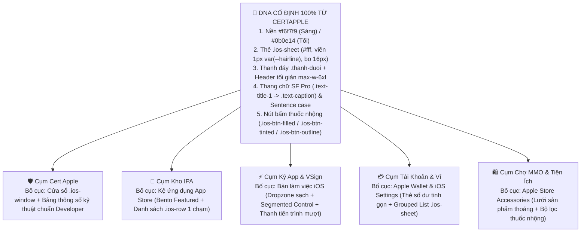

# Bản Thiết Kế & Hướng Dẫn Kỹ Thuật Đa Lớp: Nâng Cấp Toàn Hệ Sinh Thái Chuẩn "CertApple DNA" (Tùy Biến Sâu — Không Copy-Paste)

> [!IMPORTANT]
> Qua quá trình **quét đa lớp trực tiếp trên mã nguồn hiện tại** (sau đợt đồng bộ đầu tiên), hệ thống mới chỉ đạt khoảng **30% độ đồng bộ thật sự**: chỉ có `certapple/index.html` và `index.html` thực sự mang cấu trúc `.ios-sheet` / `.ios-window` chuẩn. **15/18 trang còn lại** mới chỉ được chèn thẻ `<link href="lucian-tokens.css">` và `<script src="ipaviet-theme.js">` ở phần `<head>`, còn toàn bộ HTML/CSS bên trong vẫn là giao diện cũ.

---

## PHẦN 1: QUÉT 7 LỚP KIẾN TRÚC — TẠI SAO HIỆN TẠI VẪN BỊ "LỆCH PHA" VÀ CHƯA XỊN?

| Lớp Quét | Phát Hiện Thực Tế Trong Code Hiện Tại | Hậu Quả Hiển Thị Trên Màn Hình | Giải Pháp Triệt Để Khi Bàn Giao Cho AI |
| :--- | :--- | :--- | :--- |
| **Lớp 1: Xung đột CSS nội tuyến (`<style>`)** | Các trang vẫn giữ hàng ngàn dòng CSS cũ: `sign-app/index.html` (**1.993 dòng**), `phim-tat.html` (**1.187 dòng**), `certapple/checkout.html` (**716 dòng**), `certapple/tra-cuu.html` (**534 dòng**), `account.html` (**436 dòng**). | Token mới bị CSS nội tuyến đè mất. Trang nhìn nửa sáng nửa tối, viền thẻ chỗ dày chỗ mỏng. | **Xóa sạch các biến màu tự chế** (`--bg-dark`, `--bg-canvas`) trong `<style>`, bắt buộc dùng biến gốc của `lucian-tokens.css` (`--bg`, `--surface`, `--surface-2`, `--label`, `--label-2`, `--hairline`). |
| **Lớp 2: Lỗi "Chữ Trắng Trên Nền Trắng" (Light Mode Bug)** | Khi `ipaviet-theme.js` chuyển mặc định sang nền Sáng (`#f6f7f9`), nhiều trang (như `certapple/checkout.html` dòng 383, 440, 491, 783, 871) vẫn gán cứng `color: #FFF`, `rgba(255,255,255,0.03)`, `color: #BFDBFE`. | Chữ breadcrumb *"Đăng Ký & Thanh Toán"*, bước tiến trình `.u042-dot` và khung ngân hàng **bị tàng hình hoặc đen sì** trên nền sáng. | Thay toàn bộ màu cứng `#FFF` / `rgba(255,255,255,...)` bằng `var(--label)` và `var(--fill)` / `var(--surface-2)`. |
| **Lớp 3: Đè 2 Thanh Điều Hướng Đáy (Double Bottom Nav)** | `ipaviet-theme.js` (dòng 184) chỉ ẩn `.floating-nav, .mobile-bottom-nav, #mobileBottomNav`. Nhưng `account.html`, `naptien.html`, `tap-hoa-mmo.html` dùng `<nav class="fixed bottom-0...">`, còn `app-library/*.html` dùng `<nav class="bottom-tabs">`. | Trên điện thoại xuất hiện **2 thanh điều hướng chồng đè lên nhau** ở đáy màn hình. | Gỡ bỏ các thẻ `<nav>` đáy cũ trong HTML từng trang và cập nhật bộ chọn ẩn trong `ipaviet-theme.js`. |
| **Lớp 4: Thiếu `applecert.css` trên 14/18 trang** | Chỉ có 4 file (`index.html`, `certapple/*.html`) nhúng `applecert.css`. 14 trang còn lại không có các class bố cục tinh hoa của CertApple như `.ios-band`, `.ios-grain`, `.khoi-trang`, `.ent-khoi`. | Các trang con thiếu độ sâu bề mặt, thiếu nhịp thở khoảng trắng (whitespace) và hiệu ứng chuyển cảnh mượt như `certapple/index.html`. | Trích xuất các class bố cục cốt lõi từ `applecert.css` gộp thẳng vào `lucian-tokens.css` để cả 18 trang đều dùng được. |
| **Lớp 5: Cuộn trang bị khóa (`overflow-hidden`)** | `dichvu.html` đặt `h-[100dvh] overflow-hidden` ở `<body>` và cuộn bên trong `<main>`. `support.html` cũng khóa cuộn body. | Sự kiện `window.scrollY` của thanh `.thanh-duoi` không bao giờ kích hoạt, thanh dock không tự thu gọn khi cuộn. | Bỏ `overflow-hidden` trên `<body>` (trừ khung chat trong `support.html`), để trình duyệt cuộn tự nhiên theo chuẩn iOS Safari. |
| **Lớp 6: Trộn lẫn 3 thư viện Icon & 450+ Emoji** | `support.html` còn **206 emoji**, `app-library/app.html` còn **85 emoji**, `app-library/index.html` còn **61 emoji**. `tra-cuu.html`, `sign-app`, `phim-tat`, `tap-hoa-mmo` vẫn tải FontAwesome 6.5. | Nhìn rối mắt, thiếu sự điềm tĩnh tinh tế của SVG nét mảnh (`stroke-width="1.9"`) bên `certapple/index.html`. | Gỡ FontAwesome, thay emoji chức năng bằng SVG inline hoặc Lucide icon `stroke-width="1.8"`. |
| **Lớp 7: Kiểu chữ "Viết Hoa Đầu Từ" (Title Case)** | `checkout.html`, `account.html`, `vsign.html`, `naptien.html` vẫn viết kiểu *"Xác Thực Mã UDID Thiết Bị"*, *"Nhấn Giữ 1.2s Để Xác Nhận Đã Chuyển"*. | Tạo cảm giác "giao diện do AI sinh tự động", mất chất Apple Việt Nam. | Chuyển 100% sang **Sentence case** (chỉ viết hoa chữ đầu câu và tên riêng): *"Xác thực mã UDID thiết bị"*, *"Nhấn giữ 1,2 giây để xác nhận"*. |

---

## PHẦN 2: NGUYÊN TẮC "LẤY DNA CERTAPPLE NHƯNG KHÔNG COPY-PASTE"

Để toàn bộ website **nhìn vào biết ngay cùng một đẳng cấp với `certapple/index.html`**, nhưng **mỗi trang vẫn có cá tính và bố cục chuyên biệt** (không bị nhàm chán hay giống copy-paste), bạn cần yêu cầu AI tuân thủ quy tắc **"Đồng nhất DNA — Biến hóa Bố cục"**:



### 5 Điểm Khác Biệt Giữa "Copy-Paste Thô Thiển" vs "Tùy Biến Đẳng Cấp"

1. **Không lạm dụng 3 chấm tròn macOS (`.ios-window-dot`) ở mọi nơi:**
   - Chỉ dùng `.ios-window` (có thanh tiêu đề 3 chấm tròn) cho **Thẻ Gói Cước Cert** (`certapple/index.html`) và **Khung Bàn Làm Việc Ký App trên Desktop** (`sign-app/index.html`).
   - Tất cả các trang khác phải dùng **`.ios-sheet`** (thẻ phẳng viền mảnh `1px solid var(--hairline)`, bo góc `16px`, không có 3 chấm tròn) kết hợp **`.ios-row`** (dòng danh sách ngăn cách bằng `inset 0 1px 0 var(--separator)`).
2. **Mỗi trang có 1 "Signature Component" (Thành phần điểm nhấn riêng):**
   - `certapple/index.html`: Hộp xếp **26 Entitlements** (`.ent-khoi`) + 3 thẻ gói cước `.ios-window`.
   - `certapple/checkout.html`: **Tờ hóa đơn Apple Pay Split-View** (Cột trái nhập UDID theo từng khung `.ios-sheet` đánh số; Cột phải là thẻ QR ngân hàng đặt trong khung `.ios-sheet` tĩnh lịch, không xoay vòng neon lòe loẹt).
   - `certapple/tra-cuu.html`: **Thanh tra cứu Spotlight** + **Thẻ trạng thái tiến độ Apple Developer (4 mốc thời gian rõ ràng)**.
   - `app-library/index.html` & `app.html`: **Kệ trưng bày chuẩn iOS 18 App Store** (giữ bố cục kệ ngang & lưới icon bo squircle, nhưng áp màu nền `--bg`, bề mặt `--surface`, nút `Nhận` dạng viên thuốc `.ios-btn-tinted`).
   - `account.html`: **Giao diện cài đặt iOS (iOS Settings Grouped Table)** kết hợp **Thẻ Apple Wallet** ở đầu trang và thanh chuyển Tab phân đoạn (Segmented Control).
3. **Màu nhấn (Contextual Flame) chỉ chiếm 5% diện tích màn hình:**
   - 95% giao diện là **Trắng `#ffffff` / Xám nhạt `#f6f7f9` / Đen mực `#0f1318`** (hoặc `#0b0e14` / `#14181f` ở chế độ Tối).
   - Màu nhấn (`--flame`) chỉ xuất hiện ở: **Huy hiệu nhỏ (Badge), Icon đang chọn, Giá tiền/Trạng thái quan trọng, hoặc 1 nút CTA duy nhất cần thúc đẩy hành động**. Nút bấm tiêu chuẩn dùng `.ios-btn-filled` (nền đen chữ trắng ở Light mode, nền trắng chữ đen ở Dark mode — đúng chất Apple).

---

## PHẦN 3: HƯỚNG DẪN CHI TIẾT TỪNG TRANG (ĐỂ BÀN GIAO CHO AI THỰC THI)

Dưới đây là phác thảo chi tiết theo từng cụm trang. Bạn có thể **copy nguyên từng khối hướng dẫn này giao cho AI** làm lần lượt từng cụm để kiểm soát chất lượng tuyệt đối.

---

### CỤM 1: PHÂN HỆ CHỨNG CHỈ APPLE (`certapple/`) — NƠI CHỐT ĐƠN CHÍNH

#### 1. Trang `certapple/checkout.html` (Đang mở — Cần đại tu gấp nhất!)
* **Hiện trạng & Lỗi đang mắc phải:**
  1. Dòng 1–2: Thẻ `<html>` chưa có `data-cc-xem="sang"`, chưa bọc trong `<div class="ios-root">`.
  2. Dòng 31–747: Có **716 dòng CSS nội tuyến cũ** viết cho nền đen. Khi chạy trên nền sáng `#f6f7f9`:
     - Dòng 783: `<span style="color: #FFF;">Đăng Ký & Thanh Toán</span>` -> **Chữ trắng tiệp vào nền sáng, mất chữ!**
     - Dòng 440: `.u042-dot` có `background: rgba(16, 21, 34, 0.9)` -> Hiện 3 cục tròn đen sì thô kệch trên nền sáng.
     - Dòng 491: `.u042-step-node.is-active .u042-label { color: #FFF; }` -> **Chữ tên bước biến mất trên nền sáng!**
     - Dòng 383 & 1046: `.bank-info-box` và hộp biên lai dùng `background: rgba(255, 255, 255, 0.03)` và `border-bottom: 1px solid rgba(255, 255, 255, 0.04)` -> Không thấy viền và nền ở chế độ Sáng.
     - Dòng 871: `color: #BFDBFE` (chữ xanh nhạt của Dark mode) trên nền sáng -> **Mờ nhạt không đọc được!**
     - Dòng 338–364: Hiệu ứng `.qr-radar-ring` xoay vòng 7 màu và phát sáng `.qr-radar-pulse` rất "mùi AI/Web cá cược", lệch hẳn sự điềm tĩnh của `certapple/index.html`.
* **Hướng dẫn các bước cho AI sửa `certapple/checkout.html`:**
  1. **Đồng bộ Khung & Header giống hệt `certapple/index.html`:**
     - Đặt `<html lang="vi" data-cc-xem="sang">` và bọc nội dung trong `<div class="ios-root flex min-h-[100dvh] flex-col">`.
     - Thay `<header class="checkout-nav">` bằng Header gọn gàng của `certapple/index.html`: Góc trái là logo `IPAVIET` + badge `Cert`, góc phải là nút `.ios-btn .ios-btn-tinted` *"← Chọn lại gói"*.
  2. **Thiết kế lại Thanh Tiến Trình 3 Bước (`.u042-progress-ribbon`):**
     - Bỏ cục tròn đen `rgba(16, 21, 34, 0.9)` và chữ `#FFF`.
     - Chuyển thành **Thanh bước ngang kiểu Apple Checkout**: Nền chấm tròn chưa tới dùng `var(--surface-2)`, viền `var(--separator)`, chữ `var(--label-2)`. Bước đang chọn (`is-active`) dùng nền `var(--btn-fill)` chữ `var(--btn-fill-label)`. Bước hoàn thành (`is-done`) dùng nền `var(--green)` chữ trắng. Nhãn bước dùng `color: var(--label)`.
  3. **Chuyển đổi Cột Trái sang cấu trúc `.ios-sheet` + `.ios-row`:**
     - **Khối Tóm tắt gói đang chọn:** Dùng `.ios-sheet` với thanh đầu trang mảnh hiển thị tên gói (`text-title-3 font-bold`), giá tiền dùng `text-title-1 font-extrabold text-label` (không tô màu xanh lá `#10b981` lòe loẹt), các dòng thông số (Thời gian cấp, Bảo hành, Tệp chứng chỉ) đặt trong danh sách `.ios-row` ngăn cách bằng `var(--separator)`.
     - **Khối Bước 1 (Nhập UDID) & Bước 2 (Thông tin liên hệ):** Dùng `.ios-sheet`, ô nhập liệu dùng chuẩn `.ios-field` đặt trong khung `background: var(--surface-2); border: 1px solid var(--hairline); border-radius: 12px`. Hộp gợi ý *"Chưa biết lấy UDID?"* đổi nền sang `var(--flame-soft)`, chữ `var(--label)`, nút tải cấu hình dùng `.ios-btn .ios-btn-tinted`.
     - **Khối Bước 3 (Tùy chọn nâng cấp kèm đơn):** Giữ nguyên logic `#chkAddonVip` (+25.000đ) và `#chkAddonInsurance` (+29.000đ), nhưng khi tick chọn thì viền thẻ đổi sang `border-color: var(--flame)` và nền `var(--flame-soft)` tinh tế.
  4. **Làm lại Cột Phải (Thẻ Thanh Toán VietQR Chuẩn Apple Pay):**
     - **Xóa bỏ hoàn toàn** vòng xoay neon `.qr-radar-ring` và `.qr-radar-pulse`. Thay bằng khung trắng `.ios-sheet` sạch sẽ, viền `1px solid var(--hairline)`, bóng đổ nhẹ `var(--lift)`.
     - Bảng thông tin ngân hàng BIDV dùng danh sách `.ios-row` nền `var(--surface-2)`: nhãn bên trái `var(--label-2)`, giá trị bên phải `var(--label) font-semibold`, nút Copy dùng pill nhỏ `background: var(--fill-2); color: var(--label)`.
     - Nút xác nhận **Nhấn giữ 1,2 giây (`#btnHoldConfirm`)**: Thay vì màu xanh lá neon trong suốt, hãy dùng nút đặc chuẩn CertApple (`background: var(--btn-fill); color: var(--btn-fill-label); border-radius: 999px`), khi nhấn giữ thì thanh tiến trình trượt màu `var(--flame)` hoặc `var(--green)` từ trái sang phải, chữ viết đúng chuẩn: *"Nhấn giữ 1,2 giây để xác nhận đã chuyển khoản"*.

---

#### 2. Trang `certapple/tra-cuu.html` (Tra cứu đơn hàng & Tải chứng chỉ)
* **Hiện trạng & Lỗi đang mắc phải:**
  1. Đang nhúng `font-awesome/6.5.1/css/all.min.css` (dòng 16) trong khi `certapple/index.html` dùng 100% SVG thuần.
  2. Còn hiệu ứng `.aurora-mesh` (3 đốm màu xanh-đỏ-lá bay lơ lửng từ dòng 25–65) và `.search-card-glow` làm bẩn nền xám tĩnh `#f6f7f9` của CertApple.
  3. Phần kết quả trả về và bảng lịch sử đơn hàng gần đây vẫn dùng nhiều style inline pha màu xanh dương `#0A84FF` chồng lên tông đỏ Crimson `--flame` của CertApple.
* **Hướng dẫn các bước cho AI sửa `certapple/tra-cuu.html`:**
  1. **Gỡ bỏ `.aurora-mesh` và FontAwesome**, thay các icon `<i class="fa-...">` bằng SVG nét mảnh đồng bộ với `certapple/index.html`.
  2. **Thiết kế Khung Tìm Kiếm theo chuẩn `.ios-sheet`:**
     - Đặt ô nhập UDID / Mã đơn / Email vào một `.ios-sheet` nền `var(--surface)`, viền `1px solid var(--hairline)`, bóng đổ `var(--lift)`. Nút *"Tra cứu ngay"* dùng `.ios-btn .ios-btn-filled`.
  3. **Tùy biến Thẻ Kết Quả Đơn Hàng thành "Apple Provisioning Pass":**
     - Khi tìm thấy đơn, hiển thị một thẻ `.ios-window` hoặc `.ios-sheet` chia làm 3 phần rõ rệt:
       - **Phần đầu:** Tên gói + Huy hiệu trạng thái (Đang chờ Apple duyệt = màu cam `var(--orange)` nền ấm; Đã cấp chứng chỉ = màu xanh `var(--green)`).
       - **Phần giữa (Stepper 4 bước):** *Đã tiếp nhận → Đang đăng ký UDID → Apple duyệt → Sẵn sàng tải về* (dùng đường kẻ mảnh `var(--separator)` và chấm tròn `var(--green)`).
       - **Phần cuối (Hành động):** Nút chính `.ios-btn-filled` *"Tải bộ chứng chỉ (.zip)"* + Nút phụ `.ios-btn-tinted` *"Đưa thẳng vào Trình ký App"*.
  4. **Khu vực Câu hỏi thường gặp (`.u044-accordion`):** Đổi màu nhấn khi mở từ `#0A84FF` (dòng 171, 202, 236) sang `var(--flame)` hoặc `var(--btn-fill)` để đồng nhất 100% với bảng màu CertApple.

---

#### 3. Trang `certapple/index.html` (Trang chuẩn gốc — Tinh chỉnh 5% cuối cùng)
* **Hiện trạng:** Đã rất đẹp và là khuôn mẫu chuẩn của hệ thống.
* **Điểm cần tinh chỉnh nhẹ:**
  1. Trên Header (dòng 51–63) hiện chỉ có mỗi Logo bên trái, bên phải bị trống trải so với `index.html`.
  2. Trong Modal hướng dẫn lấy UDID (cuối file) vẫn còn sót 9 emoji (`📱`, `⚙️`, `✅`).
* **Hướng dẫn cho AI:**
  - Bổ sung vào góc phải Header của `certapple/index.html` 2 nút nhỏ giống `index.html`: Nút *"Tra cứu đơn"* (`.ios-btn-tinted` nhỏ) và nút tìm kiếm `⌘K` để cân đối bố cục 2 bên.
  - Thay 9 emoji trong Modal hướng dẫn lấy UDID bằng số thứ tự tròn `1`, `2`, `3` chuẩn iOS.

---

### CỤM 2: TRANG CHỦ HỆ SINH THÁI (`index.html`)

* **Hiện trạng & Điểm cần nâng cấp:**
  - `index.html` đã được viết lại theo cấu trúc Bento 6 ô dùng `.ios-sheet` và `applecert.css` khá sạch sẽ.
  - **Tuy nhiên còn 3 điểm khiến trang chủ chưa thực sự "đắt giá":**
    1. **Dòng 229, 238, 247:** 3 icon ứng dụng nổi bật trong Bento 1 đang dùng link ảnh hoạt hình `icons8.com/fluency/96/...` (trông giả và giống icon Windows 11, không phải icon iOS thật!).
    2. **Chưa có thanh trạng thái tài khoản nhanh trên Header:** Khi khách đã đăng nhập, góc phải chỉ có icon hình người tĩnh, chưa hiện số dư Xu hay trạng thái VIP.
    3. **6 ô Bento có chiều cao và mật độ chữ hơi đều nhau**, chưa tạo được nhịp điệu thị giác (Visual Rhythm).
* **Hướng dẫn các bước cho AI sửa `index.html`:**
  1. **Thay 3 icon `icons8.com` trong Bento 1** bằng icon iOS bo góc squircle thật từ kho dữ liệu của web (hoặc iTunes artwork thật của YouTube, Spotify, TikTok/TrollStore) kèm viền mảnh `border: 0.5px solid var(--hairline)`.
  2. **Tùy biến mỗi ô Bento một cấu trúc thị giác riêng (Không lặp lại bố cục):**
     - **Bento 1 (Kho IPA - 7 cột):** Hiển thị 3 hàng `.ios-row` ứng dụng thật (có số phiên bản, dung lượng và nút `.ios-btn-tinted` *"Nhận"*).
     - **Bento 2 (Cert Apple - 5 cột):** Hiển thị mô phỏng thẻ chứng chỉ `.ios-window` thu nhỏ có mã UDID mẫu, 3 quyền Entitlements và giá `149.000 ₫`.
     - **Bento 3 (Trình ký VSign - 4 cột):** Khung kéo thả `.ipa` tương tác thật — khi khách bấm vào sẽ chuyển thẳng sang `sign-app/index.html`.
     - **Bento 4 (Chợ MMO - 4 cột):** Hiển thị danh sách 3 dịch vụ dạng pill ngang (ChatGPT Plus, YouTube Premium, CapCut Pro) kèm giá rõ ràng.
     - **Bento 5 (Phím tắt & Tiện ích - 4 cột):** Hiển thị 2 thẻ phím tắt iOS (Chặn thu hồi DNS, Lấy UDID).

---

### CỤM 3: PHÂN HỆ KHO ỨNG DỤNG IPA (`app-library/index.html`, `app.html`, `claim.html`, `ipavip.html`)

> [!TIP]
> **Định hướng tùy biến cho Kho IPA:** Tuyệt đối **KHÔNG** biến Kho IPA thành trang bán văn bản giống `certapple`. Kho IPA phải mang linh hồn của **iOS 18 App Store kết hợp bảng màu và thanh `.thanh-duoi` của CertApple**.

#### 1. Trang `app-library/index.html` (Trang chủ Kho IPA)
* **Hiện trạng & Lỗi đang mắc phải:**
  1. Có **2 thanh điều hướng dưới đáy**: `<nav class="bottom-tabs">` của `maclife-store.css` và `<nav class="thanh-duoi">` do `ipaviet-theme.js` chèn vào!
  2. Còn **61 emoji** rải rác trong tiêu đề kệ hàng (`🔥`, `👑`, `⚡`, `🎮`) và các nút lọc.
  3. Trong `maclife-store.css` vẫn còn nhiều hiệu ứng `shimmer`, `glow` và bóng đổ màu mè.
* **Hướng dẫn các bước cho AI sửa `app-library/index.html`:**
  1. **Ẩn triệt để `<nav class="bottom-tabs">`** để chỉ dùng duy nhất thanh `.thanh-duoi` chuẩn CertApple (với mục *Kho IPA* đang sáng màu `--flame` xanh `#0071e3`).
  2. **Chuẩn hóa bề mặt & khoảng trắng trong `maclife-store.css`:**
     - Áp dụng nền trang `--bg: #f6f7f9` (Dark: `#0b0e14`), thẻ ứng dụng và kệ VIP Vault dùng nền `--surface: #ffffff` (Dark: `#14181f`), viền `1px solid var(--hairline)`.
     - Nút **NHẬN** bên cạnh mỗi ứng dụng đổi về đúng chuẩn App Store: nền `var(--fill-2)`, chữ `var(--flame)` (`#0071e3`), bo tròn `999px`, cao `30px`, chữ đậm `600`, viết hoa nhẹ hoặc viết thường *"Nhận"*.
  3. **Khử 61 Emoji ở tiêu đề kệ:** Thay bằng tiêu đề chữ lớn sắc nét chuẩn iOS App Store:
     - *"Ứng dụng nổi bật tuần này"* (phụ đề: *"Cập nhật mới nhất cho iOS 16 – iOS 18"*)
     - *"Kho đặc quyền VIP"* (kèm badge nhỏ `.bg-flame-soft .text-flame` ghi `VIP`)
     - *"Trò chơi đã mở khóa tính năng"*

#### 2. Trang `app-library/app.html` (Chi tiết từng ứng dụng IPA)
* **Hiện trạng & Lỗi đang mắc phải:**
  1. Còn **85 emoji** trong các nút bấm, hộp thông báo và hướng dẫn cài đặt.
  2. Hàng thông số (Phiên bản, Dung lượng, Hệ điều hành) và cụm nút tải cần được gom gọn để trên màn hình iPhone nhìn thoáng như App Store thật.
  3. Cũng bị trùng `<nav class="bottom-tabs">` với `.thanh-duoi`.
* **Hướng dẫn các bước cho AI sửa `app-library/app.html`:**
  1. **Phần Đầu Trang (App Header):**
     - Icon ứng dụng bo góc squircle `22.5%` kích thước `88x88px` (mobile) / `112x112px` (desktop) kèm viền mảnh `1px solid var(--hairline)`.
     - Cụm nút hành động chỉ giữ **1 nút chính nổi bật** (`.ios-btn-filled` màu `--flame` `#0071e3`: *"Nhận / Cài đặt"*) và **1 nút phụ tròn/thuốc nhộng** (`.ios-btn-tinted`: *"Ký riêng & Nhân bản ⋯"*).
  2. **Dải Thông Số Ngang (App Store Spec Strip):**
     - Dùng 4 cột ngăn cách bằng vạch dọc `var(--separator)`: **PHIÊN BẢN** (`v...`) · **DUNG LƯỢNG** (`... MB`) · **HỆ ĐIỀU HÀNH** (`iOS 15.0+`) · **TRẠNG THÁI** (`Đã kiểm duyệt`).
  3. **Thẻ Gợi Ý Chéo Sang Chợ MMO (Smart Cross-Sell Card):**
     - Thiết kế dạng `.ios-sheet` gọn gàng đặt ngay dưới phần mô tả: nền `var(--surface)`, viền `1px solid var(--hairline)`, góc phải là nút `.ios-btn-tinted` *"Xem gói nâng cấp"*.

#### 3. Trang `app-library/claim.html` (Nhận thưởng vượt link) & `ipavip.html`
* **Hiện trạng:** `claim.html` đang ép cứng `data-theme="dark"` ở thẻ `<html>` và dùng 428 dòng CSS riêng; `ipavip.html` chưa có `.ios-root`.
* **Hướng dẫn cho AI:**
  - Ở `claim.html`: Bỏ ép `data-theme="dark"` để tôn trọng chế độ Sáng/Tối người dùng đang chọn; đặt hộp xác nhận nhiệm vụ vào một `.ios-sheet` căn giữa màn hình, thay pháo hoa/lửa lòe loẹt bằng biểu tượng dấu tích xanh chuẩn Apple Pay.
  - Ở `ipavip.html`: Bọc `.ios-root`, đồng bộ bảng giá VIP theo phong cách `.ios-sheet` sạch sẽ.

---

### CỤM 4: PHÂN HỆ CÔNG CỤ KÝ (`sign-app/index.html`, `vsign.html`, `vsign-install.html`)

#### 1. Trang `sign-app/index.html` (Trình ký IPA trực tuyến)
* **Hiện trạng & Lỗi đang mắc phải:**
  1. Có tới **1.993 dòng CSS nội tuyến**, vẫn giữ khung `.studio-window` với 3 nút đèn giao thông macOS (`.traffic-light.close/.min/.max` ở dòng 188–204) và thanh tiêu đề đen `rgba(11, 15, 25, 0.85)`.
  2. Khi mở trên iPhone, nhìn như một trang web desktop thu nhỏ nhét vào màn hình điện thoại.
* **Hướng dẫn các bước cho AI sửa `sign-app/index.html`:**
  1. **Loại bỏ hoàn toàn khung giả lập macOS (`.window-traffic-lights` và `.studio-titlebar` nền đen):**
     - Thay bằng **Header chuẩn CertApple** (`max-w-5xl mx-auto`): Góc trái là Logo `IPAVIET` + huy hiệu `Signer` (màu xanh `--flame`), góc phải là **Huy hiệu số dư Xu & Trạng thái Cert trong Tủ đồ** (ví dụ: *"Chứng chỉ: Đã gắn sẵn"* hoặc *"Số dư: 15.000 Xu"*).
  2. **Chia Bàn Làm Việc Ký App thành 3 Khối `.ios-sheet` Rõ Ràng (Không nhồi nhét):**
     - **Khối 1 — Chọn tệp ứng dụng (.IPA):** Dùng `.ios-sheet` có thanh chuyển đổi (Segmented Control) giữa *"Tải file .IPA từ máy"* và *"Dán đường dẫn .IPA"*. Khung chọn file thiết kế tối giản với viền nét đứt `1.5px dashed var(--vien-noi)`, nền `var(--surface-2)`.
     - **Khối 2 — Chứng chỉ ký (.P12 & .MobileProvision):**
       - Nếu tài khoản đã có `vipCert` trong tủ đồ: Hiện ngay 1 dòng `.ios-row` báo tích xanh *"Đang dùng chứng chỉ Apple Developer của thiết bị này"* (khách không cần tải file lên nữa).
       - Nếu khách muốn tự nạp file: Hiện 2 dòng `.ios-row` gọn gàng cho `.p12`, `.mobileprovision` và ô mật khẩu `.ios-field`.
     - **Khối 3 — Tùy chỉnh nâng cao (Cloner / Đổi tên / Đổi Icon / Ngụy trang):** Đặt trong một khung xếp gọn (Accordion giống `.ent-khoi` của `certapple/index.html`), mặc định đóng gọn để người mới không bị ngợp, ai cần nhân bản ứng dụng chỉ cần chạm mở ra.
  3. **Nút Ký Ứng Dụng & Trạng Thái Ký:**
     - Dùng nút `.ios-btn .ios-btn-filled` toàn chiều rộng, cao `50px`. Khi đang ký, hiển thị thanh tiến trình ngang mượt mà ngay trong `.ios-sheet` kèm phần trăm thực tế, tuyệt đối không bật màn hình chữ xanh lá kiểu hacker.

#### 2. Trang `vsign.html` & `vsign-install.html` (Giới thiệu & Cài đặt VSign Native)
* **Hiện trạng:** `vsign.html` đang dùng **39 gradient** khác nhau và nhúng FontAwesome; `vsign-install.html` chưa nhúng `lucian-tokens.css` và `ipaviet-theme.js`.
* **Hướng dẫn cho AI:**
  - Nhúng đầy đủ `applecert.css`, `lucian-tokens.css`, `ipaviet-theme.js` vào cả 2 trang.
  - Thiết kế lại phần so sánh **VSign Standard vs VSign Pro** trong `vsign.html` bằng đúng cấu trúc 2 thẻ `.ios-window` đặt cạnh nhau (giống hệt bảng giá của `certapple/index.html`), giảm 39 gradient về đúng 1 màu nhấn `--flame` (`#0071e3`).

---

### CỤM 5: PHÂN HỆ TÀI KHOẢN, DỊCH VỤ VIP & NẠP TIỀN (`account.html`, `dichvu.html`, `naptien.html`)

> [!NOTE]
> **Định hướng tùy biến cho Cụm Tài Khoản & Ví:** Mang phong cách **iOS Settings (Cài đặt iPhone) + Apple Wallet**. Sạch sẽ, phân nhóm bằng `.ios-sheet` và `.ios-row`, dùng tông màu nhấn **Amber (`data-accent="amber"`)** sang trọng.

#### 1. Trang `account.html` (Trung tâm tài khoản & Tủ đồ)
* **Hiện trạng & Lỗi đang mắc phải:**
  1. Dòng 2100+: Vẫn còn `<nav class="fixed bottom-0 left-0 right-0 z-40 apple-glass...">` gây **trùng 2 thanh điều hướng dưới đáy** với `.thanh-duoi`.
  2. Toàn bộ các khối (Hồ sơ, Số dư Ví, Tủ đồ Chứng chỉ, Cộng tác viên Affiliate, Lịch sử giao dịch, Ứng dụng đã tải) đang hiển thị nối đuôi nhau trên một trang dài tới 2.210 dòng, nhiều hộp vẫn dùng class Tailwind tối `slate-800/900`.
* **Hướng dẫn các bước cho AI sửa `account.html`:**
  1. **Xóa thẻ `<nav class="fixed bottom-0...">` cũ** ở cuối trang.
  2. **Thiết kế Khối Đầu Trang dạng "Thẻ Thành Viên + Ví Kép (Apple Wallet Card)":**
     - Một khung `.ios-sheet` duy nhất ở trên cùng: Bên trái là Avatar + Tên + Hạng thành viên (Member / VIP); Bên phải là 2 con số rõ ràng: **Số dư chính (`coins`)** và **Xu thưởng (`bonusCoins`)** cùng 2 nút `.ios-btn-filled` *"Nạp thêm"* và `.ios-btn-tinted` *"Nâng cấp VIP"*.
  3. **Bổ sung Thanh Chuyển Tab Kiểu iOS (Segmented Control 4 mục):**
     - Chia nội dung bên dưới thành 4 tab gọn gàng để trang không bị kéo dài lê thê:
       - **Tab 1: Tủ đồ & Chứng chỉ (`vipCert`):** Hiển thị trạng thái chứng chỉ UDID của máy, nút tải về `.p12/.mobileprovision`, thời hạn bảo hành.
       - **Tab 2: Lịch sử ký & Tải app:** Danh sách `.ios-row` các IPA đã ký.
       - **Tab 3: Cộng tác viên (Affiliate 15%):** Thống kê lượt click, hoa hồng khả dụng, link giới thiệu và nút đổi hoa hồng sang Xu hoặc rút tiền.
       - **Tab 4: Lịch sử giao dịch:** Bảng biến động số dư gọn sạch.

#### 2. Trang `dichvu.html` (Cửa hàng gói VIP)
* **Hiện trạng & Lỗi đang mắc phải:**
  1. Thẻ `<body>` đang để `h-[100dvh] flex flex-col overflow-hidden` và cuộn bên trong `<main>` -> làm hỏng hiệu ứng cuộn của thanh `.thanh-duoi`.
  2. Tiêu đề Hero đang pha tiếng Anh *"Premium Store. Everything you need."* không khớp với văn phong tiếng Việt của `certapple/index.html`.
* **Hướng dẫn các bước cho AI sửa `dichvu.html`:**
  1. Đổi `<body>` về chuẩn cuộn tự nhiên `min-h-[100dvh] flex flex-col`, xóa `overflow-hidden` và xóa `<nav class="floating-nav">` cũ.
  2. Viết lại tiêu đề Hero chuẩn tiếng Việt tự nhiên: *"Đặc quyền thành viên IPAVIET VIP"* — *"Mở khóa toàn bộ kho ứng dụng VIP, tự động ký theo thiết bị và tải tốc độ cao không giới hạn."*
  3. Các thẻ gói VIP (1 Tháng, 3 Tháng, 1 Năm) chuyển sang dùng `.ios-window` hoặc `.ios-sheet` đồng bộ với `certapple/index.html`, hiển thị rõ ưu tiên trừ **Xu thưởng (`bonusCoins`)** trước khi trừ ví chính.

#### 3. Trang `naptien.html` (Nạp Xu tự động qua VietQR)
* **Hiện trạng:** Bị trùng `<nav class="fixed bottom-0...">` ở đáy; bố cục chọn mệnh giá và khung QR chưa dùng `.ios-sheet`.
* **Hướng dẫn cho AI:**
  1. Xóa `<nav class="fixed bottom-0...">` cũ.
  2. Lưới chọn mệnh giá (20.000đ, 50.000đ, 100.000đ, 200.000đ, 500.000đ) thiết kế dạng các ô `.ios-sheet` nhỏ: khi chạm chọn thì viền sáng màu `var(--flame)` và nền `var(--flame-soft)`.
  3. Khung mã QR nạp tiền bên phải dùng chung thiết kế **Thẻ Apple Pay VietQR** sạch sẽ như `certapple/checkout.html` (không vòng xoay neon).

---

### CỤM 6: PHÂN HỆ CHỢ MMO & TIỆN ÍCH (`tap-hoa-mmo.html`, `mmo-product.html`, `phim-tat.html`, `support.html`, Pháp lý)

#### 1. Trang `tap-hoa-mmo.html` & `mmo-product.html` (Chợ Tài Nguyên Số MMO)
* **Hiện trạng & Lỗi đang mắc phải:**
  1. `tap-hoa-mmo.html` vẫn còn **74 vị trí dùng màu tối cứng** (`slate-800`, `slate-900`, `bg-[#0...]`) và còn thanh `<nav class="sm:hidden fixed bottom-0...">` đè lên `.thanh-duoi`.
  2. `mmo-product.html` **chưa hề được nhúng `lucian-tokens.css` và `ipaviet-theme.js`!** Khi khách bấm từ Chợ MMO vào xem chi tiết sản phẩm (`mmo-product.html`), giao diện bị đứt gãy hoàn toàn, mất thanh `.thanh-duoi` và lệch tông màu.
* **Hướng dẫn các bước cho AI sửa `tap-hoa-mmo.html` & `mmo-product.html`:**
  1. **Nhúng ngay `applecert.css`, `lucian-tokens.css`, `ipaviet-theme.js` vào `mmo-product.html`** và thêm `class="ios-root"` vào `<body>`.
  2. **Tại `tap-hoa-mmo.html`:**
     - Xóa `<nav class="sm:hidden fixed bottom-0...">` cũ.
     - Thay toàn bộ 74 class `slate-800/900` bằng biến bề mặt `var(--surface)`, `var(--surface-2)` và chữ `var(--label)`.
     - Mỗi thẻ sản phẩm MMO (Netflix, YouTube Premium, ChatGPT, CapCut...) trình bày dạng `.ios-sheet` tinh gọn: Icon ứng dụng thật (lấy từ `mmo-icon-resolver.js`) + Tên gói + Nhãn bảo hành + Giá tiền rõ ràng + Nút `.ios-btn-tinted` *"Mua ngay"*.

#### 2. Trang `phim-tat.html` (Thư viện Phím tắt iOS)
* **Hiện trạng:** Có **2 thẻ `<header>`** (`header-bar` và `header`), nhúng cả `minimalist-modern.css`, `fonts.css` (font Saira Semi Condensed lệch tông hoàn toàn với SF Pro) và **1.187 dòng CSS nội tuyến**.
* **Hướng dẫn cho AI:**
  1. Gỡ bỏ `fonts.css` và `minimalist-modern.css` để dùng duy nhất font hệ thống SF Pro từ `lucian-tokens.css`.
  2. Gộp 2 header làm 1 Header chuẩn CertApple.
  3. Mỗi thẻ Phím tắt (Shortcut Card) thiết kế theo phong cách **Ứng dụng Phím tắt (iOS Shortcuts App)** nhưng đặt trên nền `.ios-sheet` phẳng mịn, nút *"Nhận phím tắt"* dùng `.ios-btn-tinted`.

#### 3. Trang `support.html` (Trung tâm Hỗ trợ & Chat AI/Admin)
* **Hiện trạng:** Đang chứa tới **206 emoji** (nhiều nhất toàn web!) và các câu mẫu vẫn còn lỗi chuỗi `$1` trong thẻ `<h2>` (dòng tiêu đề xuất hiện chữ `$1` do regex lỗi ở lần sửa trước!).
* **Hướng dẫn cho AI:**
  1. **Sửa ngay lỗi hiển thị chữ `$1`** trong các thẻ tiêu đề của `support.html`!
  2. Thay các emoji trang trí bằng icon SVG đơn sắc tinh tế.
  3. Bố cục khung Chat giữ nguyên tính năng chuyển đổi **Trợ lý AI ↔ Kỹ thuật viên**, nhưng bong bóng chat và thanh nhập tin nhắn chuyển sang chuẩn **iMessage iOS 18** (`background: var(--surface)`, tin nhắn gửi đi màu `var(--flame)` hoặc `#0071e3`, bo góc `18px`).

#### 4. Các trang Phụ trợ (`privacy-policy.html`, `terms-of-service.html`, `404.html`, `login-app.html`)
* **Hiện trạng:** `privacy-policy.html` và `terms-of-service.html` vẫn nhúng `minimalist-modern.css` + FontAwesome và 408 dòng CSS riêng; `404.html` chưa có `.thanh-duoi`.
* **Hướng dẫn cho AI:**
  - Chuyển `privacy-policy.html` và `terms-of-service.html` về khung văn bản tài liệu chuẩn Apple Legal: Header CertApple + Nội dung đặt trong `.ios-sheet` rộng `max-w-3xl mx-auto p-6 sm:p-10`, chữ dễ đọc, xóa sạch `minimalist-modern.css`.

---

## PHẦN 4: BỘ PROMPT MẪU ĐỂ BẠN COPY BÀN GIAO CHO AI (CHIA LÀM 4 ĐỢT RÕ RÀNG)

Để AI không bị quá tải ngữ cảnh (context limit) dẫn đến làm ẩu hoặc chỉ sửa phần `<head>` mà bỏ qua phần `<body>`, bạn hãy **giao việc theo 4 đợt (4 Prompts)** dưới đây:

### 📋 Đợt 1: Nâng cấp Lõi CSS & Sửa dứt điểm Cụm CertApple (`lucian-tokens.css`, `ipaviet-theme.js`, `certapple/checkout.html`, `certapple/tra-cuu.html`, `certapple/index.html`)
```text
Hãy thực hiện Đợt 1 nâng cấp giao diện sâu theo chuẩn DNA của certapple/index.html (tuyệt đối không chỉ sửa thẻ <head>, phải sửa tận gốc DOM và CSS nội tuyến):
1. Trong ipaviet-theme.js (dòng 184): Cập nhật bộ chọn ẩn các thanh điều hướng đáy cũ thành '.floating-nav, .mobile-bottom-nav, #mobileBottomNav, .bottom-tabs, nav.fixed.bottom-0' để không bao giờ bị trùng 2 thanh dock dưới đáy.
2. Trong lucian-tokens.css: Gộp các class bố cục cốt lõi từ certapple/applecert.css (.ios-band, .khoi-trang, .ent-khoi, .ios-reveal) vào lucian-tokens.css để toàn bộ 18 trang đều dùng được mà không bị thiếu class.
3. Đại tu certapple/checkout.html (trang quan trọng nhất):
   - Sửa lỗi chữ trắng trên nền sáng (#FFF, rgba(255,255,255,0.03), #BFDBFE) ở breadcrumbs, thanh tiến trình 3 bước (.u042-dot, .u042-label), hộp gợi ý UDID và bảng thông tin ngân hàng.
   - Xóa vòng xoay neon .qr-radar-ring và .qr-radar-pulse quanh mã VietQR, thay bằng khung .ios-sheet trắng tinh tế chuẩn Apple Pay.
   - Đổi toàn bộ các khối .card-panel sang chuẩn .ios-sheet và danh sách thông số sang .ios-row.
   - Đổi chữ Title Case ("Xác Thực Mã UDID Thiết Bị", "Nhấn Giữ 1.2s Để Xác Nhận") sang Sentence case tiếng Việt tự nhiên ("Xác thực mã UDID thiết bị", "Nhấn giữ 1,2 giây để xác nhận").
4. Đại tu certapple/tra-cuu.html: Gỡ bỏ .aurora-mesh và FontAwesome, đồng bộ khung tra cứu và thẻ kết quả đơn hàng về .ios-sheet / .ios-window với màu nhấn --flame.
5. Tinh chỉnh certapple/index.html: Thêm nút "Tra cứu đơn" và nút Tìm kiếm (⌘K) vào góc phải Header cho cân đối; thay 9 emoji trong modal UDID bằng số thứ tự tròn.
```

### 📋 Đợt 2: Tùy biến Cụm Kho IPA & Công Cụ Ký (`index.html`, `app-library/*`, `sign-app/index.html`, `vsign.html`)
```text
Hãy thực hiện Đợt 2: Tùy biến giao diện Cụm Kho IPA và Cụm Ký App theo DNA CertApple (giữ bản sắc riêng của từng trang, không copy-paste rập khuôn):
1. Trang chủ index.html: Thay 3 icon hoạt hình icons8.com trong Bento 1 bằng icon iOS thật bo góc squircle; tinh chỉnh 6 ô Bento để mỗi ô có bố cục đặc trưng riêng.
2. Cụm Kho IPA (app-library/index.html, app.html, claim.html):
   - Xóa/ẩn thanh .bottom-tabs cũ để dùng duy nhất thanh .thanh-duoi.
   - Thay 61 emoji ở app-library/index.html và 85 emoji ở app.html bằng icon vector hoặc badge chữ chuẩn App Store.
   - Ở app.html: Giữ đúng 1 nút chính "Nhận / Cài đặt" nổi bật và 1 nút phụ "Tùy chọn ký ⋯", trình bày dải thông số 4 cột ngăn cách bằng var(--separator).
   - Ở claim.html: Bỏ ép cứng data-theme="dark", đưa hộp nhận thưởng về khung .ios-sheet.
3. Cụm Ký App (sign-app/index.html, vsign.html, vsign-install.html):
   - Trong sign-app/index.html: Gỡ bỏ thanh tiêu đề macOS giả (.studio-titlebar nền đen và 3 chấm .traffic-light), thay bằng Header chuẩn CertApple có hiển thị số dư Xu và trạng thái vipCert. Chia bàn làm việc thành 3 khối .ios-sheet sạch sẽ (Chọn IPA, Chứng chỉ ký, Tùy chọn nhân bản xếp gọn).
   - Trong vsign.html & vsign-install.html: Nhúng đầy đủ lucian-tokens.css và ipaviet-theme.js, giảm 39 gradient ở vsign.html về bảng màu tĩnh của CertApple, trình bày 2 gói Standard & Pro bằng .ios-window.
```

### 📋 Đợt 3: Đại tu Cụm Tài Khoản, Ví & Dịch Vụ VIP (`account.html`, `dichvu.html`, `naptien.html`)
```text
Hãy thực hiện Đợt 3: Đại tu Cụm Tài Khoản, Dịch vụ VIP và Nạp tiền theo phong cách iOS Settings + Apple Wallet (tông màu nhấn data-accent="amber"):
1. Trong account.html:
   - Xóa thẻ <nav class="fixed bottom-0..."> cũ ở cuối trang để không đè lên .thanh-duoi.
   - Thiết kế khối đầu trang dạng Thẻ Thành Viên & Ví Kép (.ios-sheet) hiển thị rõ Số dư chính (coins) và Xu thưởng (bonusCoins).
   - Thêm thanh chuyển đổi Segmented Control chia nội dung bên dưới thành 4 tab gọn gàng (Tủ đồ & Cert · Lịch sử ký · Cộng tác viên 15% · Giao dịch) thay vì xếp chồng dài lê thê.
   - Thay toàn bộ các class nền tối cứng (slate-800/900) bằng var(--surface), var(--surface-2) và danh sách .ios-row.
2. Trong dichvu.html:
   - Bỏ class overflow-hidden và h-[100dvh] trên <body> để trang cuộn tự nhiên và kích hoạt hiệu ứng thu gọn của .thanh-duoi; xóa .floating-nav cũ.
   - Chuyển tiêu đề tiếng Anh "Premium Store..." sang tiếng Việt tự nhiên chuẩn Apple; đồng bộ các thẻ gói VIP về .ios-window / .ios-sheet.
3. Trong naptien.html:
   - Xóa thẻ <nav class="fixed bottom-0..."> cũ.
   - Chuyển lưới chọn mệnh giá và khung VietQR sang chuẩn .ios-sheet đồng bộ với certapple/checkout.html.
```

### 📋 Đợt 4: Hoàn thiện Chợ MMO, Phím Tắt, Hỗ Trợ & Pháp Lý (`tap-hoa-mmo.html`, `mmo-product.html`, `phim-tat.html`, `support.html`, `privacy-policy.html`, `terms-of-service.html`)
```text
Hãy thực hiện Đợt 4: Hoàn thiện 100% các trang Chợ MMO, Phím tắt, Hỗ trợ và Pháp lý theo chuẩn CertApple:
1. Trong mmo-product.html: Nhúng đầy đủ lucian-tokens.css, ipaviet-theme.js, ipaviet-search.css và bọc .ios-root để không bị đứt gãy giao diện khi chuyển từ tap-hoa-mmo.html sang.
2. Trong tap-hoa-mmo.html: Xóa <nav class="sm:hidden fixed bottom-0..."> cũ; thay toàn bộ 74 class màu tối cứng (slate-800/900) bằng biến bề mặt .ios-sheet (--surface, --hairline, --label).
3. Trong phim-tat.html: Gỡ bỏ fonts.css (font Saira lệch tông) và minimalist-modern.css; gộp 2 thẻ <header> trùng lặp thành 1 Header chuẩn CertApple; trình bày các thẻ phím tắt trên bề mặt .ios-sheet.
4. Trong support.html: Sửa ngay lỗi hiển thị ký tự "$1" trong các thẻ <h2>; thay thế 206 emoji bằng icon vector đơn sắc; làm sạch khung chat theo chuẩn iMessage iOS 18 trên bề mặt .ios-sheet.
5. Trong privacy-policy.html & terms-of-service.html: Gỡ bỏ minimalist-modern.css và FontAwesome, đặt nội dung điều khoản vào khung tài liệu .ios-sheet sạch sẽ.
```
